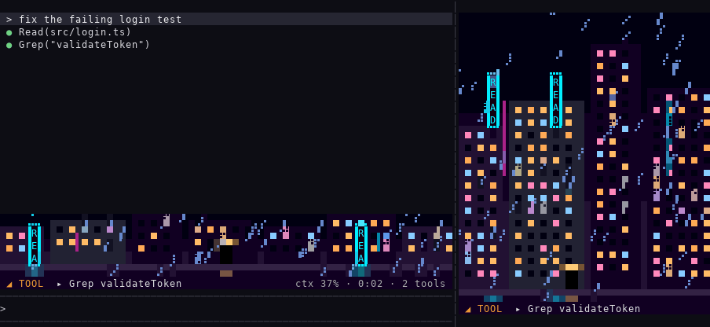

# kaizo 改造

**Useful things I build for Claude Code, in one marketplace.** Add it once, then install only the ones you want.

```
/plugin marketplace add nmicovic/kaizo
```

| Name | What it is | Type | Version |
|---|---|---|---|
| [**neongai**](neongai/README.md) ネオン街 | A neon city above your prompt that shows what Claude is doing | mod | 0.4.0 |

---

## neongai ネオン街

**See what Claude is doing at a glance.** A neon city at night lives right above your prompt, and in a side view if you want one, and moves with Claude:

- it races while Claude runs tools
- a neon sign lights up for every tool call
- it stops and pulses red when Claude needs you
- its lights go out one by one as the context fills



It uses no tokens: it only watches, and passes every event through unchanged. Six scenes come with it:

- this alley
- a scrolling skyline
- Matrix-style code rain
- a spinning wireframe
- a warp-speed starfield
- a synthwave sunset

**[See all six scenes, the commands and how to read them →](neongai/README.md)**

```
/plugin install neongai@kaizo
/neongai
```

## License

MIT
