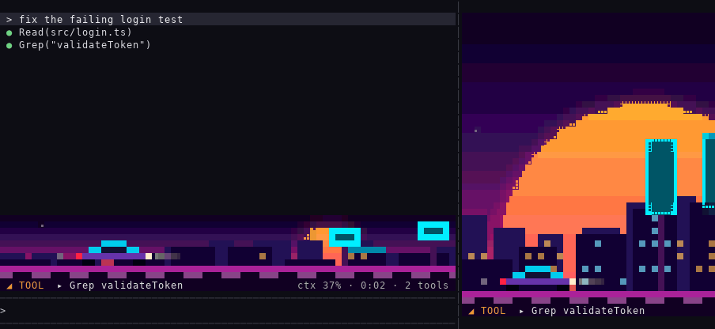
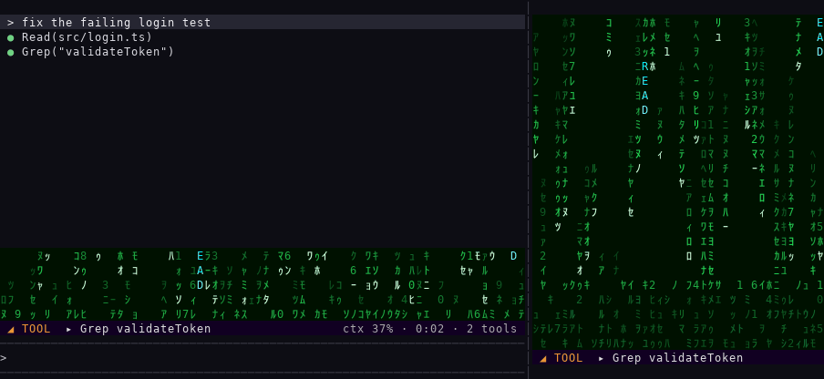
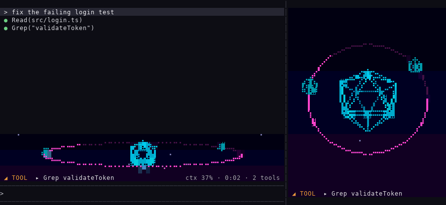
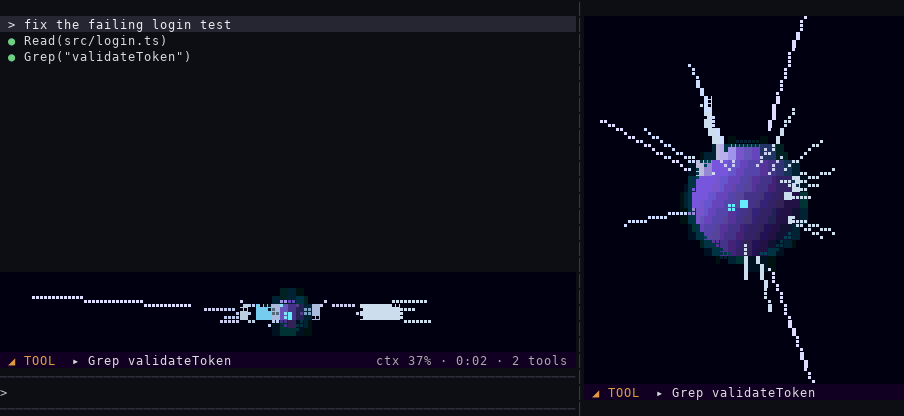
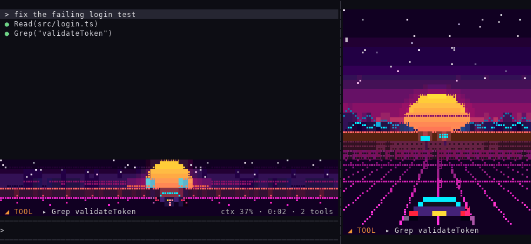

# neongai ネオン街

A neon city at night that shows what Claude is doing at a glance: right above your prompt, and in a side view if you want one.


## Install

```
/plugin marketplace add nmicovic/kaizo
/plugin install neongai@kaizo
/neongai
```

## Why use it

- **Know what Claude is doing without reading the transcript.** Thinking, running tools, writing or done: the scene's pace and its status line tell you from the corner of your eye.
- **Never miss "Claude needs you".** When a question or a permission prompt is waiting, the scene stops and pulses red, and Claude Code's own status line says so too.
- **Watch the context window fill.** The sun sets, windows go dark, code piles up, so you see the context running out before a compaction surprises you.
- **Feel the rhythm of a turn.** Every tool call leaves a colored mark: cyan for reads, pink for edits, amber for commands, red for failures.
- **It costs nothing.** No tokens: it only watches, passes every event through unchanged, and stops drawing when it's off.

## Two views

| Command | What you get |
|---|---|
| `/neongai` | **The strip**: a scene just above the prompt, as wide as the conversation. It is 6 rows tall while Claude works and shrinks to one status line when Claude is idle. Fold it away with `ctrl+x ctrl+a`. It stays on in your next sessions until you run `/neongai` again. |
| `/neongai pane` | **The side view**: a tall scene in a pane beside the conversation. Run it again to close the pane. |

## Scenes

- `/neongai scene` (or `/neongai scene list`) shows every scene and what each view has now.
- `/neongai scene <name>` changes the strip.
- `/neongai pane <name>` opens the side view with that scene.

Each view remembers its scene across sessions.

Each GIF below plays the same turn inside Claude Code, with the strip above the prompt and the side view docked on the right:

1. a prompt
2. two reads and an edit
3. a failing test
4. a question for you
5. a passing test
6. the end of the turn

The context fills from 20% to 75% along the way.

### `alley`: a rainy neon street

Each tool call lights a vertical sign spelling its kind, reflected in the wet street. The windows go dark as the context fills. The rain comes down harder the busier Claude is and stops when Claude needs you, while the light over the door pulses red. Works in the strip and the side view.

The GIF at the top of this page.

### `skyline`: a neon city scrolling past

Signs drive by for each tool call, and the sun sets as the context fills. The road's edge and the car's lights pulse red when Claude needs you. The strip's default; works in the side view too.



### `code-rain`: green code raining down, Matrix style

Each tool call falls as a word in its kind's color. Settled code piles up as the context fills, and the rain freezes, its heads pulsing red, when Claude needs you. STAGE CLEAR settles out of the rain at the end. Works in the strip and the side view.



### `wireframe`: a spinning 3D solid with a ring of light

A small cube orbits once for each tool call, and the ring's light shrinks as the context fills. The spin stops and the edges blink red when Claude needs you. At the end, the solid bursts into points and comes back together. Works in the strip and the side view.



### `warp`: stars streaming past a ship

The stars stretch into streaks when Claude is busy, and a comet flies by for each tool call. The planet ahead grows as the context fills. When Claude needs you, the ship drops out of warp and a red alert frames the view. Works in the strip and the side view.



### `sunset`: a road running into a synthwave sunset

The sun sets as the context fills, a sign goes up by the road for each tool call, and the car's tail lights pulse red when Claude needs you. The side view's default; works in the strip too, with a lower horizon and a bigger sun.



## Reading any scene

Every scene shows the same five things:

| Scene | Context left | Busier | A tool call | Claude needs you | A turn ends |
|---|---|---|---|---|---|
| alley | windows go dark | the rain comes down harder | a neon sign spells the tool's kind | the rain stops; the door light pulses red | every window lights up |
| skyline, sunset | the sun sets; more stars | the city or road moves faster | a neon sign drives past | everything stops; lights pulse red | sparkles |
| code-rain | settled code piles up | the rain falls faster and thicker | the tool's kind falls as a word | the rain freezes; heads pulse red | STAGE CLEAR settles out |
| wireframe | the ring's light shrinks | the solid spins faster | a small cube orbits once | the spin stops; edges blink red | it bursts into points and back |
| warp | the planet ahead grows | stars stretch into streaks | a comet flies past | out of warp; a red alert frame | a flash |

- **Tool colors, in every scene:** cyan for read or search, pink for edit or write, amber for a command, green for web or MCP, violet for an agent or skill, red for a failure.
- **The status line,** in every scene: `◢ TOOL  ▸ Bash npm test   ctx 63% · 0:14 · 7 tools`.

"Claude needs you" means a question is waiting for your answer, or a permission prompt has been open for 2 seconds. Claude Code's own status line says so too, in case a dialog covers the view.

## Good to know

- **Terminal only.** The desktop app shows a short note instead.
- **Fonts.** Every scene draws fine detail (stars, rain, thin lines) with braille dots, and code-rain also needs half-width katakana. To check, run `printf 'ｱｲｳｴｵ ﾊﾋﾌﾍﾎ ⠁⠃⠇⡇⣇⣿\n'`. Boxes or question marks mean your font lacks them: details will look off, so try another font, or a scene with fewer of them.
- **tmux.** Inside tmux, Claude Code draws only 256 colors unless it is started with this variable:
  ```
  export CLAUDE_CODE_TMUX_TRUECOLOR=1
  ```
  tmux itself also needs 24-bit color for your terminal, for example `set -as terminal-features ',xterm-256color:RGB'`.
- **Cost.** Watch-only: every event passes through unchanged, it uses no tokens, and it stops drawing when both views are off.

## License

MIT
